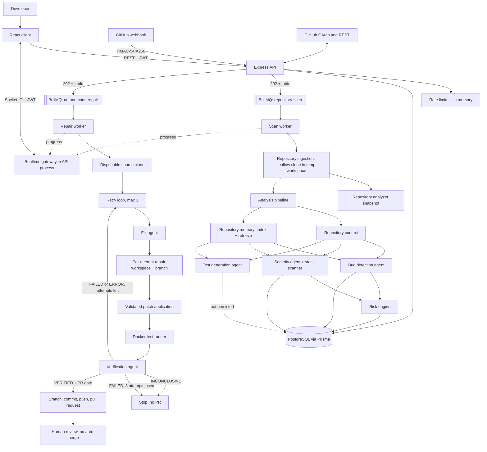

# RepoDoctor AI — Architecture and Design

**Scope:** this document describes the implemented design. Status labels are defined in [Development history §1.2](DEVELOPMENT_HISTORY.md#12-status-labels-used-identically-in-every-document). Day references (for example "Day 17") point to sections of the [Day 1–30 history](DEVELOPMENT_HISTORY.md). Test status for each area is in [Testing](TESTING_EVALUATION_DEMO.md).

## 1. System goals

RepoDoctor is a student portfolio project that attempts to detect selected classes of defects in JavaScript and TypeScript repositories, propose fixes, apply them in an isolated workspace, run tests in Docker, verify the evidence, retry a bounded number of times and open a GitHub pull request only when verification succeeds. It never merges. Passing tests is evidence, not proof of correctness.

The defensible product claim is: *RepoDoctor attempts to detect selected classes of defects in JavaScript/TypeScript repositories, proposes and applies fixes in an isolated environment, verifies them through automated tests, and creates a pull request when validation succeeds.* An end-to-end run supporting that sentence has **not** yet been recorded.

## 2. Actual technology stack

| Layer | Implementation | Source of truth |
|---|---|---|
| Web client | React 19, TypeScript, Vite, axios, `socket.io-client` | `client/package.json` |
| API | Node 22, Express 5, TypeScript, ESM/NodeNext | `server/package.json`, `server/tsconfig.json` |
| Database | **PostgreSQL via Prisma 6** (not MongoDB); 16 migrations | `server/prisma/` |
| Queue | Redis + BullMQ 5; two queues, two worker processes | `server/src/queue/`, `server/src/workers/` |
| Real-time | Socket.IO 4 with JWT handshake; per-user rooms | `server/src/realtime/socket.ts` |
| AI | `AIProviderManager`: OpenRouter → Groq → Gemini | `server/src/ai/` |
| Execution | `docker run` through `child_process.execFile` | `server/src/execution/docker.runner.ts` |
| GitHub | OAuth, REST (axios), git over HTTPS, webhooks | `server/src/github/`, `server/src/services/github.service.ts` |
| Memory/RAG | Lexical hashed vectors in PostgreSQL JSON | `server/src/rag/`, `server/src/services/repository-memory.service.ts` |
| Deployment | `docker-compose.yml` (see defects in [Operations](OPERATIONS_SECURITY.md)) | repository root |

Not present: refresh tokens, CI/CD workflows, AWS deployment, a vector database, neural embeddings, Prettier/ESLint for the server.

## 3. System diagram

This diagram is the single reference architecture. Other diagrams in the documentation are subsets of it. Dashed arrows mark flows that are **partially implemented or indirect** (generated tests are not persisted; progress reaches the gateway through Redis queue events). Known gaps are listed in §9.



## 4. Source layout

```text
client/src/            App.tsx, pages/{Repositories,RepositoryAnalysis,AnalysisHistory}.tsx, lib/, services/, types/
server/src/
  app.ts, server.ts    Express app (rate limit, CORS, JSON with raw body) and process bootstrap
  routes/ controllers/ HTTP layer
  services/            persistence and orchestration (ingestion, analysis, repair job, PR, memory ...)
  pipeline/            runAnalysisPipeline
  context/             buildRepositoryContext, formatter, filters
  agents/ prompts/     bug, security, test-generation, fix, verification agents
  ai/                  provider interface, three providers, manager, factory
  analyzers/           repository.analyzer.ts
  risk/                risk calculator, engine, rules
  repair/              workspace, patch, branch, retry/
  execution/           docker.runner.ts
  github/              REST client, PR service, PR body, webhook signature
  queue/ workers/      scan and repair queues and workers
  realtime/            socket.ts
  rag/                 chunker, lexical embedding
  security/            token encryption, command policy, untrusted wrapper, static scanner
  benchmark/           evaluator and CLI
  test-*.ts            focused scripts (not a test framework)
server/prisma/         schema.prisma and migrations
server/benchmarks/     seeded-repo fixture and ground truth
docker-compose.yml, server/Dockerfile, client/Dockerfile, client/nginx.conf
bug-test-repo/ security-test-repo/ test-generation-repo/   local fixtures (git-ignored)
```

## 5. HTTP and event surface

| Method and path | Auth | Purpose |
|---|---|---|
| `GET /api/health` | none | liveness message |
| `POST /api/auth/register`, `POST /api/auth/login` | none, rate limited | account creation, JWT |
| `GET /api/auth/me` | JWT | current user |
| `GET /api/github/connect` | JWT | OAuth URL with signed state |
| `GET /api/github/callback` | state cookie | store GitHub token |
| `GET /api/github/repositories` | JWT | sync and list repositories |
| `POST /api/github/webhook` | HMAC signature | enqueue scan for push / same-repo PR |
| `GET /api/repositories`, `GET /api/repositories/:id`, `DELETE /api/repositories/:id` | JWT | manage repositories |
| `POST /api/repositories/ingest` | JWT | enqueue scan, returns `202` and `jobId` |
| `GET /api/repositories/jobs/:jobId` | JWT, owner only | scan job state |
| `GET /api/repositories/:id/analyses`, `GET /api/repositories/:id/analysis/latest` | JWT | analysis history, findings, risk |
| `POST /api/repairs` | JWT | enqueue repair for a finding with `testCommand` array |
| `GET /api/repairs/jobs/:jobId` | JWT, owner only | repair job state |

Socket.IO events (server → client, to room `user:<userId>`): `scan:progress`, `scan:completed`, `scan:failed`, `repair:progress`, `repair:completed`, `repair:failed`.

## 6. Analysis flow

1. `POST /api/repositories/ingest` checks ownership and a stored GitHub token, then enqueues a `repository-scan` job (`manual-<uuid>`), or a webhook enqueues `github-<deliveryId>`.
2. The scan worker creates an `Analysis` row and calls `ingestRepository`: shallow clone of one branch into `os.tmpdir()/repodoctor/<uuid>`, token passed through git environment variables, never in the URL.
3. `analyzeRepository` builds the snapshot; `saveAnalysis` stores it.
4. `runAnalysisPipeline(analysisId, repositoryId, repositoryPath)`:
   1. `buildRepositoryContext(repositoryPath, repositoryId)` (up to 30 JS/TS files of at most 50 KB).
   2. Repository memory: `indexRepositoryMemory`, `retrieveRepositoryMemory` (6 chunks), appended to the prompt. Failure is logged and skipped.
   3. `BugDetectionAgent`, then `SecurityAgent` (AI + six regex rules), then `TestGenerationAgent`, then risk evaluation. Bug, security and risk results are persisted. **Generated tests are not persisted.**
   4. `Analysis.status` moves `RUNNING` → `COMPLETED` or `FAILED`.
5. The workspace is deleted in a `finally` block.

Provider order is OpenRouter, Groq, Gemini. `ai.config.ts` throws at import if `OPENROUTER_API_KEY` is empty. The repository-context call needs both `repositoryPath` and `repositoryId`. TypeScript imports use `.js` suffixes (for example `import { runDockerTest } from "../execution/docker.runner.js"`).

## 7. Repair flow and invariants

```text
POST /api/repairs  (analysisId, findingId, testCommand[])
   → ownership checks → BullMQ autonomous-repair (attempts: 1)
   → repair worker: shallow clone of Analysis.sourceRef into a disposable workspace
   → runAutonomousRepair → RepairJob row
   → runRepairRetryLoop, up to 3 attempts, each in a NEW workspace/branch:
        FixAgent.generateFix → save FixProposal
        applyFixResult(workspace.repositoryPath, fixResult)
        runDockerTest(...) → save DockerTestRun
        verifyFix(...) → save VerificationResult
        VERIFIED      → publishVerifiedRepairWithCleanup → PullRequest row; stop
        INCONCLUSIVE  → stop, no PR
        FAILED/ERROR  → replan with previous Docker + verification evidence; next attempt
        exception     → status ERROR; stop
   → 3rd failure → MAX_RETRIES_REACHED
```

Contracts used throughout the code: `buildRepositoryContext(repositoryPath, repositoryId)`, `applyFixResult(repositoryPath, fixResult)`, `removeRepairWorkspace(workspace.rootPath)`. `repositoryPath` passed to `applyFixResult` is always the per-attempt workspace.

### 7.1 Publication gate

`publishVerifiedRepair` refuses unless all hold: `status === "VERIFIED"`, `testPassed === true`, `regressionDetected === false`, `confidence >= 0.7`, current branch equals the repair branch and is not the base, and the working tree has changes. It never force-pushes, never pushes the base branch and never merges. See the limitation below: the verdict comes from an LLM.

### 7.2 Data model (Prisma)

`User` → `Repository` → `Analysis` → { `BugFinding`, `SecurityFinding`, `GeneratedTest` (never written by the pipeline), `RiskAssessment`, `FixProposal`, `VerificationResult`, `PullRequest`, `RepairJob` → `RepairJobAttempt` }. Standalone: `DockerTestRun`, `RepairAttempt` (keyed by ids, no foreign keys), `RepositoryMemoryChunk` (→ `Repository`), `SecurityAuditEvent` (never written). `User.githubAccessToken` is plain text.

## 8. Queue, webhook and real-time architecture

- **Queues:** `repository-scan` (3 attempts, exponential back-off from 2 s) and `autonomous-repair` (1 attempt). Both keep completed jobs 24 h (max 2,000) and failed jobs 7 days (max 5,000).
- **Workers:** `scan.worker.ts` (default concurrency 2) and `repair.worker.ts` (default concurrency 1). Both need `DATABASE_URL`, Redis settings and the git binary; the repair worker also needs a reachable Docker daemon.
- **Webhook:** signature checked over the raw body before the payload is parsed; supported events are `ping`, `push` (branch refs) and `pull_request` (`opened`, `reopened`, `synchronize`, `ready_for_review`) from the same repository. Fork PRs are deliberately ignored. A redelivery reuses the job id `github-<deliveryId>`.
- **Real-time:** the API process runs a `QueueEvents` listener per queue and forwards events to the owner's room. REST job-status endpoints are the recovery path; the client uses them for scans but not for repairs. The API process requires Redis to start.

## 9. Trust boundaries and known design limitations

| Data | Trust | Handling in the code |
|---|---|---|
| API input | untrusted | field validation in controllers; ownership filters on every query |
| Webhook body | untrusted until HMAC passes | raw-body HMAC, constant-time compare |
| Repository files, scripts | untrusted | read statically; tests run only inside Docker |
| AI output | untrusted | JSON-schema validation; patch path/range/original-code checks |
| Test output | untrusted evidence | truncated at 1,000,000 characters; fed to the verification model |
| GitHub token | secret | passed via git environment; **stored unencrypted**; not given to Docker |
| Retrieved memory | untrusted | prefixed with an untrusted-data warning |

Limitations that affect the architecture:

1. **Verification is model-driven.** No code path independently requires the Docker run to have exited 0 before accepting `VERIFIED`.
2. **Test dependencies.** Workspaces contain no `node_modules` and Docker has no network, so repositories whose tests need installed packages will fail or be inconclusive.
3. **Context selection** is the first 30 JS/TS files in traversal order, not finding-relevant files; the Fix Agent does not receive retrieved memory.
4. **Memory** is lexical retrieval, rebuilt per scan, not filtered by branch/commit.
5. **Security modules not connected:** token encryption, the strict command policy, the untrusted-context wrapper and the audit-event service. See [Operations and security §3](OPERATIONS_SECURITY.md#3-security-control-status).
6. **Deployment:** Compose is development-oriented and, as written, would not start a working stack (listed in [Operations §6](OPERATIONS_SECURITY.md#6-docker-compose-reality-check)).
7. `express-rate-limit` is declared in `server/package.json` and covered by `npm run test:app`.

## 10. Architecture acceptance criteria

Before calling the architecture production-ready, demonstrate in a clean environment that: API, both workers, PostgreSQL, Redis and the client start and report health; a scan is enqueued once and de-duplicated by delivery id; findings are persisted; a repair uses a disposable workspace and cannot mutate the source clone; the test container has no network, secrets or excess resources; failed and inconclusive verification never create a PR; a verified repair opens an unmerged PR in a disposable repository; missed socket events can be recovered through the status endpoints.
